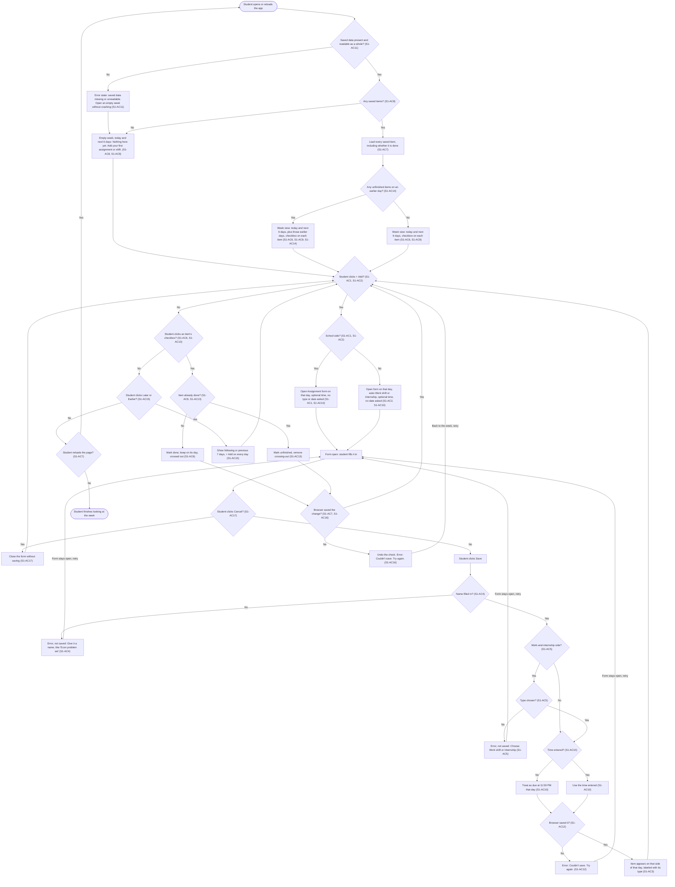
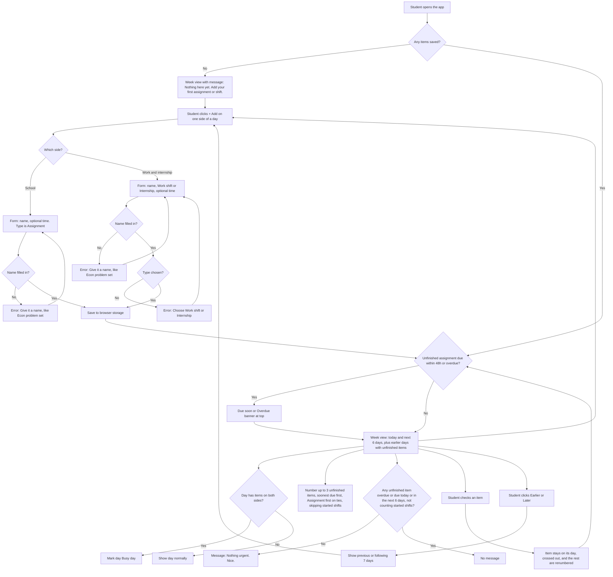

# Process flow

## S1, put everything in one place

This flow covers S1 in [`specs/user-stories.md`](../specs/user-stories.md): opening the week, adding an item, checking it off, and moving between weeks. A shorter overview of S1 to S3 is at the end. Screen: [Mockup B](mockups/b-two-sided-week.html).

There is one role (the student), and browser storage is part of the app, so there are no swimlanes.

### Which ACs each path covers

| Path | ACs |
|---|---|
| Open, saved data missing or unreadable, empty week | S1-AC11, then S1-AC8 and S1-AC9 |
| Open, data readable but no items, empty week | S1-AC8, S1-AC9 |
| Open or reload with saved items | S1-AC6 (checkbox shown), S1-AC7, S1-AC9, S1-AC14 |
| Add on the School side | S1-AC1, S1-AC3, S1-AC10 |
| Add on the Work-and-internship side | S1-AC2, S1-AC3, S1-AC10 |
| Empty name, retry | S1-AC4 |
| No type chosen, retry | S1-AC5 |
| Save fails, retry | S1-AC12 |
| Cancel the form | S1-AC17 |
| Check or uncheck an item | S1-AC6, S1-AC7, S1-AC13 |
| Checkbox change can't be saved, retry | S1-AC16 |
| Later or Earlier | S1-AC15 |

### ACs the flow doesn't reach

**None.** S1-AC1 to S1-AC17 each appear on at least one node.

S2 and S3 criteria are not in this flow, because it covers S1 only. Their main steps are in the overview below.

### Open questions

These have no S1 criterion, so the diagram doesn't invent an answer:

- **Both errors at once.** If the name and type are both missing, the diagram checks the name first. No criterion sets that order.
- **First visit.** A new student has no saved data, so they take the S1-AC11 "missing" path. It looks the same as the normal empty week, but so does lost data.
- **Later items after a reload.** S1-AC7 says every saved item still shows, but S1-AC9 shows only 7 days. Items further out need Later.

## Overview: S1–S3

This is the earlier diagram of the whole v1 loop, unchanged. It leaves out some newer S1 rules, such as save failures and Cancel. Where the two differ, follow the S1 flow above and [`specs/user-stories.md`](../specs/user-stories.md).

