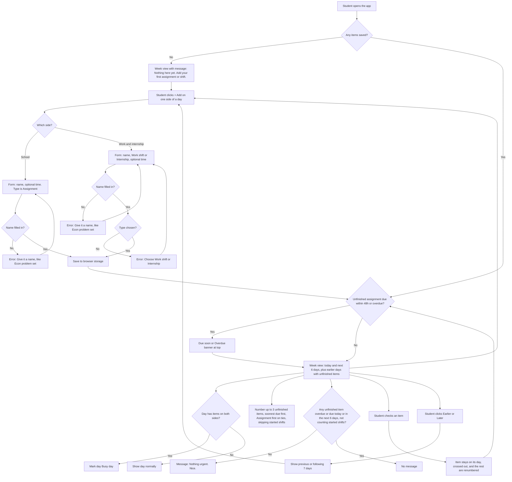

# Process flow: the main loop (S1 to S3)

This flow covers the student's main task: get everything into one place, then see what to do first. Everything happens on one screen, the two-sided week in [Mockup B](mockups/b-two-sided-week.html). It includes the empty state, the validation errors, and what happens when the list runs out.

There is one role (the student) and no other system in v1, so the diagram needs no swimlanes. If Canvas or Google Calendar import is added later, give each one a subgraph.

