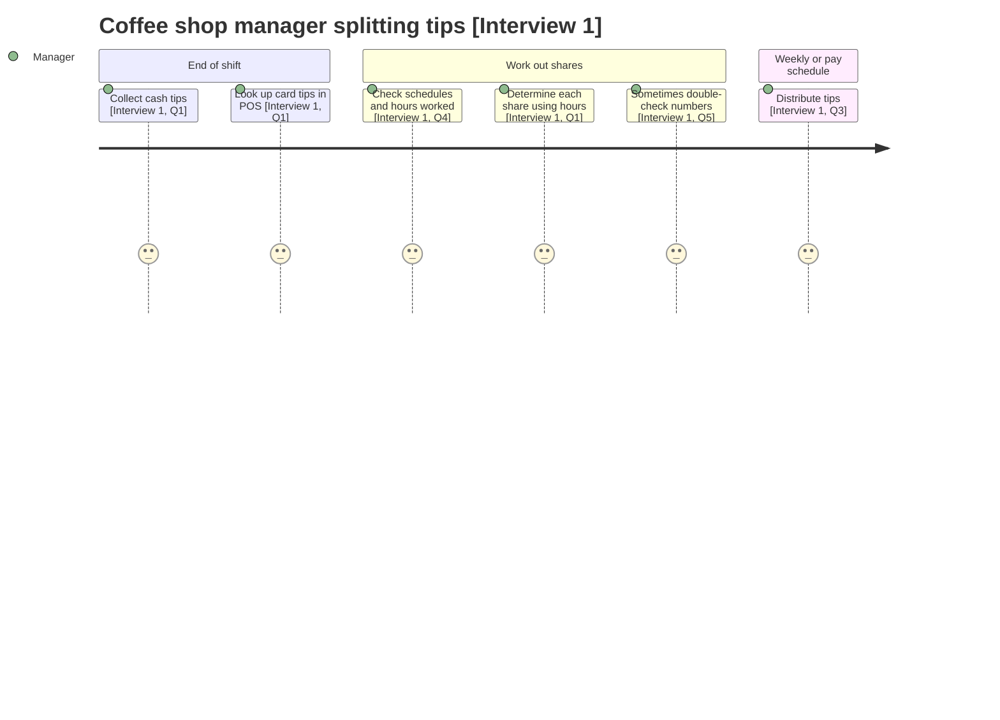
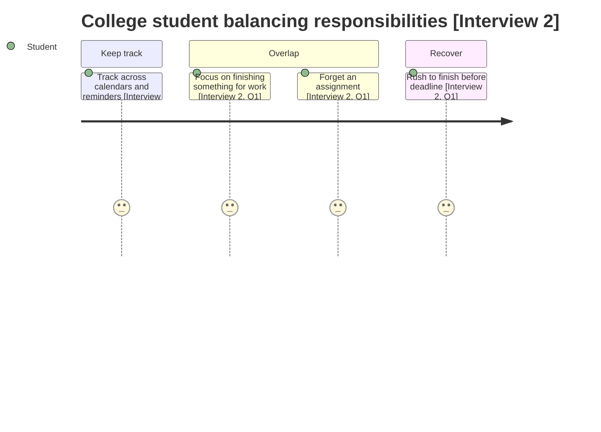

# Requirements (draft)

Sources: Interview 1 (coffee shop manager) and Interview 2 (college student). Citations give the question number, for example [Interview 1, Q2].

The interviews describe two different problems, so each section is split:

- **Problem A:** calculating and distributing tips [Interview 1, Q1]
- **Problem B:** balancing school, work, and other responsibilities [Interview 2, Q1]

Evidence that one system should solve both problems: No evidence yet.

## Problem statement

**Problem A.** The shop has to split cash and credit card tips among employees [Interview 1, Q1] who work different hours and shifts [Interview 1, Q2]. The manager says the hardest part is "making sure tips are split fairly" [Interview 1, Q2]. Tracking everything manually "can get confusing," and numbers sometimes have to be double-checked, especially when employees switch shifts [Interview 1, Q5].

**Problem B.** The student has assignments, work shifts, and internship tasks happening at the same time "pretty much every week" [Interview 2, Q3]. Their information is "spread out across different apps" [Interview 2, Q4], and they sometimes don't know what to prioritize when deadlines overlap [Interview 2, Q2]. Last week they forgot an assignment and had to rush to complete it before the deadline [Interview 2, Q1].

## Job to be done

**Problem A.** When cash and credit card tips need to be divided [Interview 1, Q1] among people who work different hours and shifts [Interview 1, Q2], I want the calculations to be accurate [Interview 1, Q2], so that tips are split fairly [Interview 1, Q2].

**Problem B.** When assignments and work deadlines overlap [Interview 2, Q2], I want to keep everything organized and know what to prioritize [Interview 2, Q2], so that I don't forget an assignment and have to rush [Interview 2, Q1].

## Users and stakeholders

| Problem | Who | Type | Interest | Source |
|---|---|---|---|---|
| A | Coffee shop manager | User | Wants tips split fairly and calculated accurately | Interview 1, Q2 |
| A | Employees | Stakeholder | Receive a share of tips based on hours worked | Interview 1, Q1 |
| A | Other stakeholders | No evidence yet | No evidence yet | No evidence yet |
| B | College student | User | Wants to keep many responsibilities organized and prioritized | Interview 2, Q2 |
| B | Other stakeholders | No evidence yet | No evidence yet | No evidence yet |

## Persona

Each persona rests on one interview.

| | Persona A: Coffee shop manager | Source | Persona B: College student | Source |
|---|---|---|---|---|
| Situation | Tips are collected every shift and calculated and distributed weekly or on the regular pay schedule | Interview 1, Q3 | Has assignments, work shifts, and internship tasks at the same time, pretty much every week | Interview 2, Q3 |
| Goal | Split tips fairly, with accurate calculations | Interview 1, Q2 | Keep everything organized and know what to prioritize | Interview 2, Q2 |
| Frustration | Manual tracking gets confusing and numbers need double-checking | Interview 1, Q5 | Information is spread out across different apps | Interview 2, Q4 |
| Tools | POS system, employee schedules, hours worked | Interview 1, Q4 | Canvas, Google Calendar, Notes app, phone reminders | Interview 2, Q4 |
| Tried without success | Keeping track of everything manually | Interview 1, Q5 | A planner and daily to-do lists | Interview 2, Q5 |
| Age, background, technical skill | No evidence yet | No evidence yet | No evidence yet | No evidence yet |

## Current process

**Problem A**

| Step | What happens now | Source |
|---|---|---|
| 1 | At the end of the shift, cash tips are collected | Interview 1, Q1 |
| 2 | Cash tips are counted separately from credit card tips | Interview 1, Q4 |
| 3 | Credit card tips are looked up through the POS system | Interview 1, Q1 |
| 4 | Employee schedules and hours worked are checked | Interview 1, Q4 |
| 5 | Each employee's share is determined using hours worked | Interview 1, Q1 |
| 6 | Numbers are sometimes double-checked, especially after shift switches | Interview 1, Q5 |
| 7 | Tips are calculated and distributed weekly or on the regular pay schedule | Interview 1, Q3 |

- Exact formula for a share: No evidence yet.
- Who performs each step (the manager says "we" [Interview 1, Q1]): No evidence yet.
- The exact order of steps 2 to 6 is assembled from separate answers [Interview 1, Q1, Q4, Q5]. Confirmation of that order: No evidence yet.

**Problem B**

| Step | What happens now | Source |
|---|---|---|
| 1 | Checks assignments in Canvas | Interview 2, Q4 |
| 2 | Uses Google Calendar for work schedule and personal events | Interview 2, Q4 |
| 3 | Sometimes writes things to do in the Notes app | Interview 2, Q4 |
| 4 | Uses reminders on their phone | Interview 2, Q4 |
| 5 | Last week, focused on finishing something for work and forgot an assignment | Interview 2, Q1 |
| 6 | Rushed to complete the assignment before the deadline | Interview 2, Q1 |

- Order in which the tools in steps 1 to 4 are used: No evidence yet.
- Where internship tasks are tracked: No evidence yet.

## Journey map

Mermaid requires a feeling score from 1 to 5 for each step. Feeling scores: No evidence yet, so every 3 below is a placeholder.

**Problem A**

**Problem B**

## Functional requirements

Neither interviewee was asked for features. Each requirement below is derived from the evidence beside it.

| ID | The system should | Evidence | Source |
|---|---|---|---|
| FR-A1 | Record cash tips for each shift | Tips are collected every shift; cash is counted separately | Interview 1, Q3, Q4 |
| FR-A2 | Record credit card tip amounts from the POS system | The POS system tracks credit card tips | Interview 1, Q4 |
| FR-A3 | Record the hours each employee worked | Hours worked are used to determine shares | Interview 1, Q1 |
| FR-A4 | Calculate each employee's share using hours worked | Hours worked are used to determine shares | Interview 1, Q1 |
| FR-A5 | Total tips for the week or pay period | Tips are distributed weekly or on the regular pay schedule | Interview 1, Q3 |
| FR-A6 | Let hours be corrected after a shift switch | Numbers need double-checking, especially after shift switches | Interview 1, Q5 |
| FR-B1 | Show assignments, work shifts, and internship tasks in one place | These overlap weekly, and information is spread across apps | Interview 2, Q3, Q4 |
| FR-B2 | Show when assignment and work deadlines overlap | Prioritizing is hard when these deadlines overlap | Interview 2, Q2 |
| FR-B3 | Help the student choose what to work on first | "Sometimes I don't know what I should prioritize" | Interview 2, Q2 |
| FR-B4 | Make upcoming assignments noticeable during busy work periods | Forgot an assignment while focused on work | Interview 2, Q1 |
| FR-B5 | Keep a daily list from growing too long | Adds too many things and gets overwhelmed | Interview 2, Q5 |

## Non-functional requirements

| ID | Category | Requirement | Source |
|---|---|---|---|
| NFR-A1 | Accuracy | Tip calculations must be accurate | Interview 1, Q2 |
| NFR-A2 | Clarity | Tip records should be less confusing than manual tracking | Interview 1, Q5 |
| NFR-B1 | Usability | Should not depend on the student remembering to update it, as the planner did | Interview 2, Q5 |
| NFR-B2 | Simplicity | Should not overwhelm the student the way long to-do lists did | Interview 2, Q5 |
| - | Security and privacy | No evidence yet | No evidence yet |
| - | Performance | No evidence yet | No evidence yet |
| - | Availability and devices | No evidence yet | No evidence yet |
| - | Accessibility | No evidence yet | No evidence yet |
| - | Measurable targets for the requirements above | No evidence yet | No evidence yet |

## Riskiest assumption

Choosing which assumption is riskiest is a judgment for the student to confirm.

| Problem | Assumption | Evidence so far | Source | Still untested |
|---|---|---|---|---|
| A | Splitting tips by hours worked is what people consider fair | Hours are used to determine shares, and the manager wants a fair split | Interview 1, Q1, Q2 | Employees' view of fairness: No evidence yet |
| B | The student will keep using one more tool | Did not always remember to update a planner | Interview 2, Q5 | Willingness to switch tools: No evidence yet |

## MVP scope

These are candidates tied to the pain each interviewee reported. Which problem to build for: No evidence yet.

| Problem | Candidate for MVP | Reason | Source |
|---|---|---|---|
| A | FR-A1, FR-A2, FR-A3, FR-A4 | Cover the inputs and calculation described | Interview 1, Q1, Q4 |
| A | FR-A6 | Shift switches are a named trouble spot | Interview 1, Q5 |
| B | FR-B1 | Information is spread out across different apps | Interview 2, Q4 |
| B | FR-B2, FR-B3 | Prioritizing overlapping deadlines is part of the hardest part | Interview 2, Q2 |

- Out of scope: No evidence yet.
- Success measure: No evidence yet.
